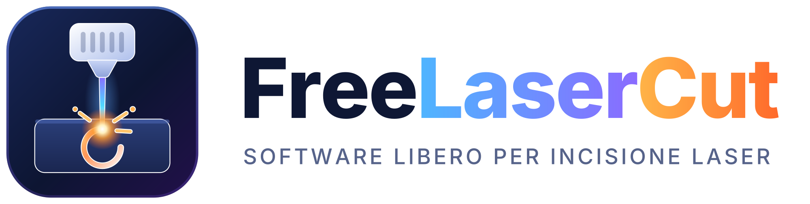
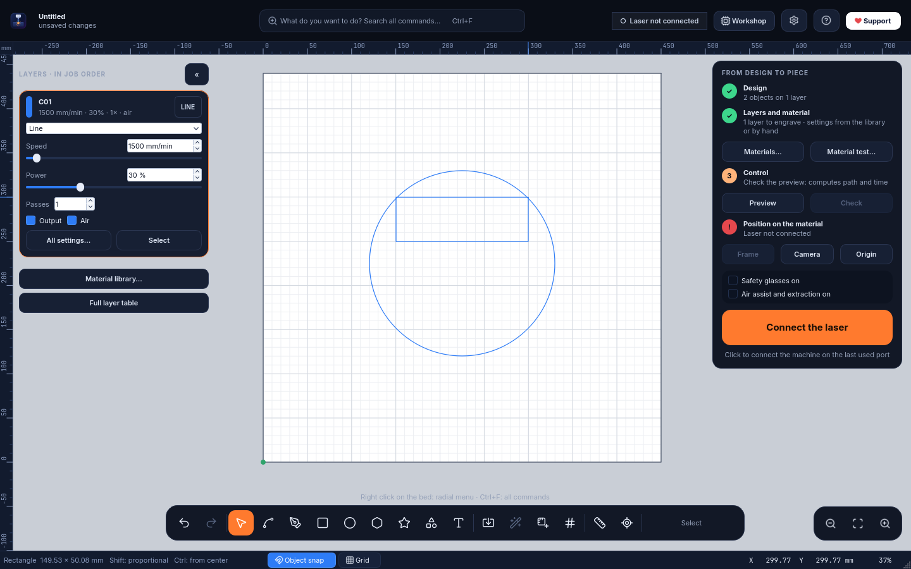

<p align="center"></p>

# FreeLaserCut (FLC)

> **Interface languages:** English · Italiano · Español · Français · Português — *Settings → Language*.
> **Video tutorials:** [YouTube · Free Laser Cut](https://www.youtube.com/@FreeLaserCut)
> **Website:** https://fringuello79.github.io/FreeLaserCut/ · **Nesting** (Arrange → Optimize space, Alt+N) · ready-made profiles for Longer, Ortur, xTool, Atomstack, Sculpfun, Creality Falcon, Two Trees, Comgrow and any GRBL laser.
> **Two interfaces:** *Workbench* (full-screen bed, command search, radial menu, second-monitor aware) or *Classic* — *Settings → Interface*.
> Free (GPL-3.0) laser engraving and cutting software for GRBL machines, native profile for the Longer B1 40W.
> Windows installer and **Linux AppImage** in **Releases**. The Linux version is the same program with the same automated tests, but real-machine testing on Linux is done by the people who install it: please report problems with *Help → Send a report to support*. Documentation below is in Italian.

Software **libero** di incisione e taglio laser per macchine GRBL, con profilo nativo per il **Longer B1 40W**.
Di **fringuello79** · licenza **GNU GPL 3.0 o successiva** (vedi `LICENSE`).
Video tutorial sul canale YouTube **[Free Laser Cut](https://www.youtube.com/@FreeLaserCut)** (anche dal programma: *Aiuto → Video tutorial su YouTube*).

Versione **0.18.3**: **circuiti stampati dai file Gerber** (*File → Importa*: rame, fori e contorno della basetta con le misure vere, specchio proposto da solo per il lato sotto, anche a **due facce** su due piani di lavoro) e, dopo il nesting, **i pezzi si scelgono di nuovo uno per uno con un clic**. Dalla 0.18.2 (**raggio degli angoli nella barra in alto**: campo **R** accanto a L e A, e i quattro angoli del rettangolo uno per uno; **poligoni e stelle con gli angoli arrotondati**). Dalla 0.18.1 (nuova **versione per Linux** (AppImage), che esce insieme a quella per Windows con lo stesso numero; vedi *Installazione (Linux)*). Dalla 0.17.18 (**Sculpfun C1** 3W e 6W nei modelli pronti). Dalla 0.17.17 (dopo le forbici i pezzi che si toccano restano **una forma sola**, che si sposta e si riempie insieme; *Unisci estremi* corretto per le linee orientate al contrario). Dalla 0.17.16 (**forbici**, tasto X: un clic toglie il tratto di linea fra due incroci; **distanza esatta** fra due oggetti, *Disponi → Distanza esatta…*: spazio fra i bordi, fra i centri o fra bordi scelti, in mm; Rilievo 3D su tavola con test di profondità obbligatorio, per ora in prova e non ancora attivo per tutti). Dalla 0.17.15 (raggio degli angoli giusto anche sui rettangoli ridimensionati, con il massimo in vista). Dalla 0.17.14 (**Acmer P3** nel catalogo con i dati ufficiali; *Importa un profilo macchina* legge anche il profilo **.lbdev** del produttore). Dalla 0.17.13 (**raccordo anche su un angolo solo**: nel rettangolo un raggio per ogni angolo, su qualsiasi forma tasto A sul nodo con lo strumento Nodi). Dalla 0.17.12 (Schizzo del soggetto con il pennello di nuovo veloce, **zoom sulla foto originale** e cerchio del pennello; **asse Z e autofocus con sonda**, *Laser → Asse Z e autofocus…*). Dalla 0.17.11 (aggiornamento dal programma più robusto: gli errori di scaricamento si vedono e quelli passeggeri si riprovano da soli). Dalla 0.17.10 (rapporti all'assistenza riconosciuti e raggruppati per problema). Dalla 0.17.8 (pulsante **Invia** del rapporto all'assistenza attivo: il rapporto arriva al progetto con un clic). Dalla 0.17.7 (*Aiuto → Invia un rapporto all'assistenza…*: descrizione del problema e rapporto tecnico inviati al progetto con un clic o con la mail già scritta, solo con il consenso; rapporto più completo; linguette dei piani più leggibili). Dalla 0.17.6 (Schizzo del soggetto con **pennelli precisi** come una gomma, *Segui i bordi* a richiesta, riquadro che tiene tutto quello che sta dentro e velo rosso sulle parti tolte; il simulatore non tocca più il profilo della macchina vera). Dalla 0.17.5 (calibrazione della camera con i **punti messi a mano** sui dischi incisi, pannello *Camera* → *Metti i punti a mano sui dischi incisi…*: FreeLaserCut dice quale disco cercare e dopo i primi quattro trova gli altri da solo). Dalla 0.17.4 (un profilo salvato con un'area di lavoro assurda si sistema da solo all'apertura; area di lavoro impostabile a mano nel pannello *Macchina* anche senza laser collegato). Dalla 0.17.3 (le schede ESP32 che restano mute anche dopo il reset morbido, per esempio con il chip CH9102, si riavviano da sole dalla porta USB come con il pulsante; strumento Misura ben visibile). Dalla 0.17.2 (area di lavoro non credibile letta dalla scheda, per esempio 400 × 234500, ignorata con avviso e seconda lettura; avviso quando una foto molto fitta è troppo veloce per la porta seriale e la testa andrebbe a scatti, con la scelta di **compattare** il G-code all'avvio; spiegazione degli override sopra il 100%; **Mecpow X3S 7W e 12W** nel catalogo, 51 modelli pronti). Dalla 0.17.1 (aiuti per il soggetto dello Schizzo più prevedibili: il riquadro esclude sempre il fuori, *Togli* e *Tieni* agiscono solo intorno al pennello; schizzo più leggero). Dalla 0.17.0 (**Schizzo del soggetto** rifatto: tratto a matita più realistico e volti riconoscibili, aiuti per il soggetto con riquadro e pennelli *Tieni* / *Togli* per togliere ombre e oggetti dietro). Dalla 0.16.3 (le schede ESP32 che restano mute dopo la connessione ricevono da sole un reset morbido, come il pulsante sulla scheda). Dalla 0.16.2 (homing non riuscito non più preso per buono: niente più lavori fermi in partenza per «fuori dall'area»; la finestra del codice QR del telefono si apre davanti). Dalla 0.16.1 (velocità della porta seriale anche a mano, *Laser → Velocità della porta seriale…* o tasto destro su Connetti, con prova prima di salvarla; avviso se la scheda collegata non risponde). Dalla 0.16.0 (nuovi **materiali imparati**: dalla foto del test materiale FreeLaserCut impara come risponde il tuo legno, la curva si affina a ogni foto e poi prevede il risultato nell'anteprima, dice che potenza serve per il tono che vuoi e corregge i toni delle foto in scala di grigi; *Laser → Materiali imparati…*). Dalla 0.15.0 (nuovi **piani di lavoro**: più lavori nello stesso progetto, con linguette *Piano 1*, *Piano 2*… sul bordo del piatto; mentre il laser incide un piano si prepara il successivo, con gli oggetti degli altri piani visibili in grigio e una **vista d'insieme** con tutti i piani affiancati; tutto in un solo file). Dalla 0.14.2 (Scultura 3D più sicura con i modelli scaricati: l'altezza di partenza è quella vera del modello, avviso prima di creare una scultura enorme, avanzamento con **Annulla** e pezzi sistemati sui fogli molto più in fretta: niente più blocchi). Dalla 0.14.1 (anteprima 3D della scultura **disegnata dalla scheda grafica**: si gira in tempo reale, bordi lisci, legno e ombre più realistici; sui PC dove la scheda grafica non va si usa da sola l'anteprima semplice). Dalla 0.14.0 (nuova **Scultura 3D da modello**, *Strumenti → Scultura 3D da modello…*: un modello `.stl` o `.obj`, o uno dei modelli inclusi, diventa una scultura in legno a strati da incollare o a incastro senza colla, con anteprima 3D che si gira con il mouse, animazione del montaggio e pezzi già numerati e sistemati sui fogli; nuovo effetto **Schizzo del soggetto (sfondo tolto)** in *Prepara foto*: il soggetto in primo piano disegnato a matita, lo sfondo bianco). Dalla 0.13.6 (nuovo **Puzzle da foto**, *Strumenti → Puzzle da foto…*: incastri sempre diversi, anche a forma di cuore, cerchio o di una forma tua, con la foto incisa prima e il taglio per ultimo; l'installatore chiude da solo il collegamento con l'app Claude che bloccava gli aggiornamenti). Dalla 0.13.5 (nuovo effetto **Ritratto a matita** in *Prepara foto*; **partenza delle immagini** a scelta: dall'alto, dal basso, da sinistra o da destra; spiegazioni del retino; **Longer Ray5 10W e 20W** separati, 49 modelli pronti; logo con il bordo bianco). Dalla 0.13.4 (**48 modelli pronti**, 8 nuovi verificati sulle pagine dei produttori: Mecpow X3/X4/X5, Longer Ray5 Mini, Creality Falcon 5W, Atomstack A70 Max; **profili macchina da condividere**, *Laser → Esporta/Importa*; *Aiuto → Video tutorial su YouTube*). Dalla 0.13.3 (**effetti per le foto**: matita, carboncino, china, fumetto, incisione a linee, linee ondulate, puntinismo, posterizza, rilievo). Dalla 0.13.2 (versione di controllo: verifica solo a macchina ferma, foto e disegni su livelli separati, configurazione guidata e assi più affidabili, foto dei telefoni dritte). Dalla 0.13.1 (**livello di aiuto** Principiante, Normale o Esperto in *Impostazioni*: una sola voce attiva). Dalla 0.13.0 (**configurazione guidata della macchina** al primo avvio e da *Impostazioni*: modello, angolo dello 0, prova delle frecce; spiegazioni passando sui segni del piano; **modalità esperto** con meno scritte d'aiuto). Dalla 0.12.6 (foto dei progetti `.lbrn2` uguali sul piano e in *Prepara foto*; aperti anche i progetti che davano l'errore «c0x»). Dalla 0.12.5 (sul piano due segni diversi: la testa del laser e il punto di partenza del lavoro). Dalla 0.12.4 (pulsante **Porta la testa qui**: la testa va sul punto del disegno scelto con i 9 pallini). Dalla 0.12.3 (l'anteprima segue subito il punto di riferimento; puntino fino al 20% con avviso oltre il 5%). Dalla 0.12.2 (**assi X/Y invertibili** dal pannello Laser; velocità anche in **mm/s**, *Impostazioni → Unità di misura*; scheda **MKS DLC32** riconosciuta). Dalla 0.12.1 (verifica e avvio più sicuri sulle schede di altri produttori, per esempio Acmer: niente più movimenti a laser spento, verifica che non resta ferma, lavori senza G55 dove serve). Dalla 0.12.0 (**laser in Wi-Fi**; **copie automatiche delle impostazioni della scheda** con ripristino; **39 modelli pronti**). Dalla 0.11.2 (dal telefono **controllo attività** con la camera dal vivo e logo). Dalla 0.11.1 (guardia fiamme che vede anche il cuore chiaro della fiamma; **nomi sotto i comandi** a richiesta, *Aiuto → Mostra i nomi sotto i comandi*). Dalla 0.11.0 (**guardia fiamme** con la camera, spenta di partenza; **taratura da foto** del test materiale; **controllo dal telefono** con Pausa, Stop, avanzamento, camera e invio della foto del test). Dalla 0.10.8 (progetti `.lbrn2` aperti dritti: foto non più specchiate, testi al loro posto). Dalla 0.10.7 (la scelta della telecamera si ricorda: con «Nessuna telecamera» la webcam del PC non si accende più). Dalla 0.10.6 (**tema chiaro** o scuro e colore principale a scelta: *Impostazioni → Aspetto*). Dalla 0.10.5 (**correzione della scansione avanti e indietro** con prova da incidere, *Laser → Correzione della scansione…*; profilo pronto per l'**Acmer S1**). Dalla 0.10.4 (**aggiornamento dal programma**: *Aiuto → Cerca aggiornamenti…*; verifica del lavoro più sicura con i limiti software della scheda; l'installatore riconosce davvero FreeLaserCut aperto, provato su Windows 11; primo avvio più rapido; *Aiuto → Crea rapporto per l'assistenza* e registro della comunicazione con la scheda). Dalla 0.10.3 (più reattivo sui PC lenti, suggerimenti dei comandi immediati, *Ottimizza lo spazio* nella barra in alto). Dalla 0.10.2 (zoom in *Prepara foto* per vedere da vicino i punti veri del metodo di incisione; chiusa l'anteprima, la foto non resta più arancione). Dalla 0.10.1 (avvio più robusto: istanza unica, errori d'avvio visibili, installatore che controlla se il programma è aperto e collegamento «FreeLaserCut (diagnostica)»). Dalla 0.10.0: nuovo **Prepara foto** (ritaglio, sfondo, contrasto, maschera, materiali pronti, prova su 4 tasselli) e **foto → linee e riempimento** che si adattano da soli alla foto; foto molto più veloci da elaborare e da vedere in anteprima. Dalla 0.9.2: fine lavoro solo a testa ferma, piano pulito dopo aver eliminato le forme. Dalla 0.9.0: **codici QR e a barre** con numeri di serie, **testo su tracciato**, **rotativo** per bicchieri e cilindri, **nesting su più pannelli** con **linee di taglio comuni**. Dalla 0.8.0: nesting e modelli pronti per i laser più diffusi. Dalla 0.7.0: nuova interfaccia **Banco** (predefinita) con il piano a tutto schermo, ricerca di tutti i comandi, menu radiale e adattamento automatico al secondo monitor; l'interfaccia di prima resta come **Classica** (Impostazioni → Interfaccia). Dalla 0.6.0: interfaccia in inglese, italiano, spagnolo, francese e portoghese (Impostazioni → Lingua). Dalla 0.5.2: schermata d'avvio con il logo e pulsante **Sostieni FreeLaserCut** in alto a destra. Dalla 0.5.1: nuovo nome (prima si chiamava *Freeburn*) e nuovo logo. I progetti `.fbrn` si aprono ancora; i nuovi si salvano come `.flcut`. Al primo avvio profili, materiali, camera e preferenze di Freeburn vengono copiati da soli in FreeLaserCut.

## Installazione (Windows)

Scarica **`FreeLaserCut-<versione>-Setup.exe`** dalla pagina **Releases** di questo repository e aprilo.
Tutto il necessario è incluso: non serve installare Python e non servono permessi da amministratore.
L'installatore non è firmato digitalmente: Windows può mostrare *"PC protetto da Windows"* → **Ulteriori informazioni → Esegui comunque**.
Per verificare il file scaricato confrontalo con `SHA256SUMS.txt` della stessa release (in PowerShell: `Get-FileHash .\FreeLaserCut-<versione>-Setup.exe`).

**Aggiornare:** dalla 0.10.4 basta *Aiuto → Cerca aggiornamenti…*: FreeLaserCut scarica la nuova versione da questa pagina Releases, ne controlla l'impronta SHA-256, si chiude, si aggiorna e si riapre da solo. Al primo avvio chiede se può controllare da solo una volta al giorno (non invia dati, solo una richiesta a GitHub). In alternativa si installa la nuova versione sopra la vecchia: progetti, profili e materiali restano. La versione del Microsoft Store si aggiorna dallo Store.

## Installazione (Linux)

Scarica **`FreeLaserCut-<versione>-x86_64.AppImage`** dalla stessa pagina **Releases** (o dal sito), rendilo eseguibile e aprilo:

```
chmod +x FreeLaserCut-*-x86_64.AppImage
./FreeLaserCut-*-x86_64.AppImage
```

(dal file manager: tasto destro → *Proprietà* → *Permessi* → *Consenti l'esecuzione come programma*, poi doppio clic).
È un solo file con dentro tutto, come l'installatore per Windows: non serve installare niente e non servono permessi da amministratore. Al primo avvio FreeLaserCut propone di aggiungersi al **menu delle applicazioni** e di aprire i progetti `.flcut` con il doppio clic (anche più tardi, da *Aiuto*). Serve un PC a 64 bit (x86_64) con una distribuzione del 2022 o più recente: Ubuntu 22.04, Debian 12, Fedora 35, Linux Mint 21, openSUSE Tumbleweed, Arch e successive (le librerie di Qt 6 chiedono glibc 2.34 o più recente).

- **Porta USB del laser.** I driver dei chip USB (CH340, CP210x, FTDI) sono già nel sistema e la porta compare come `/dev/ttyUSB0` o `/dev/ttyACM0`. Per aprirla il tuo utente deve essere nel gruppo `dialout` (`uucp` su Arch): `sudo usermod -aG dialout $USER`, poi esci dalla sessione e rientra. *Laser → Riconosci la macchina → Permesso della porta USB…* lo spiega e copia il comando. Il collegamento in **Wi-Fi** non ha bisogno di permessi.
- **Aggiornare:** *Aiuto → Cerca aggiornamenti…*, come su Windows: FreeLaserCut scarica la nuova AppImage, ne controlla l'impronta SHA-256, la mette al posto di quella vecchia (stesso file, stessa cartella) e si riapre.
- **Se non parte:** su qualche sistema manca FUSE; allora `./FreeLaserCut-*-x86_64.AppImage --appimage-extract-and-run`. Con `--self-test` FreeLaserCut fa una prova di avvio senza toccare le tue impostazioni e stampa le informazioni tecniche da allegare a una segnalazione.
- **Claude:** l'app Claude per desktop non c'è ufficialmente per Linux; il collegamento funziona con **Claude Code** (*Aiuto → Collega a Claude* mostra la riga da usare).

### Chi collauda la versione per Linux

La versione per Linux viene costruita dallo stesso codice di quella per Windows, esce insieme a lei con lo stesso numero di versione e passa le stesse prove automatiche, più una prova di avvio su Ubuntu e su altre distribuzioni (Debian, Fedora, Arch) fatta dai server di GitHub. **Lo sviluppo e le prove con il laser e la camera veri però si fanno su Windows**: su Linux non si possono ripetere a ogni versione, perché distribuzioni, desktop e configurazioni sono troppi. Per questo **il collaudo su Linux lo fa chi installa il programma, sul proprio computer**.

Se qualcosa non va (porta USB, camera, finestre, lavoro sulla macchina, aggiornamento…), segnalalo da **Aiuto → Invia un rapporto all'assistenza**: il rapporto contiene già la distribuzione, il desktop (X11 o Wayland), lo stato delle porte USB e le altre informazioni tecniche, e parte solo con il tuo consenso. Basta raccontare cosa è successo. Ogni rapporto serve a correggere il problema per tutti nelle versioni successive, che escono sempre insieme per Windows e Linux.

## Lingua

Al primo avvio FreeLaserCut usa la lingua di Windows se è tra inglese, italiano, spagnolo, francese e portoghese, altrimenti l'inglese. Si cambia da **Impostazioni → Lingua / Language** (anche Visualizza → Lingua nella Classica): la nuova lingua vale dal riavvio, che il programma propone subito. I testi sono in `freelasercut/locale/<lingua>.json` (chiave = testo italiano nel codice): correzioni e nuove lingue sono benvenute. La guida "?" dei comandi per ora è solo in italiano.

## Avvio dal codice sorgente (Windows)

Doppio clic su **`run_freelasercut.bat`** (oppure sul collegamento **FreeLaserCut** del Desktop).
La prima volta, e dopo ogni aggiornamento, installa da solo le librerie nuove: ci vuole qualche minuto.

> Chiudi gli altri programmi per il laser prima di connetterti: la porta USB la può usare un solo programma alla volta.

## Le due interfacce

Al primo avvio FreeLaserCut chiede quale usare; si cambia quando vuoi da **Impostazioni → Interfaccia** (vale dal riavvio, che il programma propone). I comandi sono gli stessi: cambia solo la disposizione.

### Banco (predefinita)

<p align="center"></p>

Progettata partendo dagli studi sull'usabilità delle interfacce: bersagli grandi e vicini a dove si lavora (legge di Fitts), poche scelte per volta (Hick-Hyman), comandi che compaiono quando servono (*progressive disclosure*), menu radiali (Callahan, Kurtenbach e Buxton) e uso del secondo monitor come spazio di lavoro (Czerwinski e altri).

| Zona | Cosa c'è |
| --- | --- |
| Barra in alto | Progetto, **ricerca comandi** (Ctrl+F / F3), stato della macchina (clic = connetti), **Officina**, **⚙ Impostazioni**, guida "?", **Sostieni** |
| Sinistra | **Strati** nell'ordine di lavoro: clic su una scheda per velocità, potenza, passate, modalità, aria, incisione. « riduce gli strati a una colonna di colori |
| Destra | **Dal disegno al pezzo**: i quattro passi con il loro stato, materiali, test, anteprima, verifica, contorno, camera, origine, conferme di sicurezza e avvio (tieni premuto). Con una selezione, sopra compaiono le **Proprietà** |
| Vicino alla selezione | **Barra contestuale**: X/Y/larghezza/altezza/rotazione, livello, allinea, combina, serie, altro |
| In basso | **Isola degli strumenti** (annulla/ripeti, disegno, importa, vettorizza, misure esatte, testo variabile, misura, posiziona laser) e zoom |
| Tasto destro sul piano | **Menu radiale** con 8 comandi sulla forma sotto il cursore (o sul piano vuoto) |
| Durante l'incisione | **Cabina**: tempo rimanente, ora di fine, velocità e potenza ±10%, aria, **Pausa** e **Stop** grandi |
| Officina (Ctrl+Shift+W) | Laser, Movimento, Camera, Macchina, Console, tabella completa dei livelli. **Con due monitor va da sola sul secondo** (Impostazioni → Officina sul secondo monitor) |

### Classica


| Zona | Cosa c'è |
| --- | --- |
| Barra in alto | File, modifica, booleane, rifletti/ruota, allinea/distribuisci, offset, serie, zoom, anteprima · porta USB e **Connetti** |
| Barra numerica | X / Y / Larghezza / Altezza in **mm** e Rotazione, con **ancoraggio a 9 punti** e lucchetto delle proporzioni. A destra: **livello della selezione** e **centra sul piano**. I campi accettano calcoli e unità: `120/3`, `2in`, `5cm`, `+10`, `*2` |
| Strumenti (sinistra) | Selezione V · Nodi N · Linee e curve L · Rettangolo R · Ellisse E · Poligono P · Stella S · Testo T · Misura M · Posiziona laser Q |
| Tavolozza (in basso) | 30 livelli colore + **T1** (livello strumenti, mai inciso): clic = assegna il colore alla selezione |
| Pannelli (destra) | **Livelli**, **Proprietà** · **Laser**, **Movimento**, **Camera**, **Macchina**, **Console**. Si spostano, si staccano e si richiudono (menu Visualizza → Pannelli) |

Premi **F1** per l'elenco completo delle scorciatoie (valgono in entrambe le interfacce).

## Ottimizza lo spazio (nesting)

**Disponi → Ottimizza lo spazio** (Alt+N; nel Banco anche dalla barra contestuale e dal menu radiale) sistema i pezzi sul materiale sprecandone il meno possibile.

- Usa la **sagoma vera** di ogni pezzo: un cerchio può entrare nell'angolo di una L, una forma irregolare accanto a un'altra.
- **Pezzi**: la selezione oppure, se non selezioni niente, tutte le forme. Le forme bloccate e quelle non selezionate restano ferme e vengono evitate. Le forme una dentro l'altra (un'incisione nel suo contorno di taglio) si spostano insieme anche senza raggrupparle; le copie sovrapposte invece vengono distribuite.
- **Materiale**: il piano intero, un rettangolo su misura oppure un contorno disegnato sul **livello T1**, anche un avanzo irregolare. Selezionalo insieme ai pezzi.
- **Distanza tra i pezzi** (almeno lo spessore del taglio), **margine dal bordo**, **rotazioni** (nessuna, 180°, 90°, 45°, 15°: con le venature del legno o le foto conviene nessuna o 180°), **precisione** normale o alta.
- Il risultato indica quanti pezzi sono stati sistemati, il materiale usato e la resa in %. I pezzi che non entrano restano dove erano e vengono selezionati. **Ctrl+Z** annulla tutto in un colpo.
- **Più pannelli**: se i pezzi non entrano, continuano su altri pannelli uguali affiancati a destra, ognuno col suo contorno e il suo numero sul livello T1. Si incide un pannello alla volta, selezionandolo e usando "Solo gli oggetti selezionati".
- **Linee di taglio comuni**: i pezzi vengono accostati e i lati in comune si tagliano una volta sola, con meno tempo e meno bruciature. Lo stesso fa *Disponi → Unisci le linee di taglio comuni* su qualsiasi selezione, per esempio una serie a griglia con distanza 0. Funziona sui lati dritti; il kerf non si applica ai lati condivisi.

## Codici QR e a barre

*Strumenti → Codice QR o a barre…* (Ctrl+Alt+Q).

- **Tipi**: QR, Code 128, EAN-13, EAN-8, UPC-A, Code 39. Il codice diventa una forma vettoriale con i moduli uniti, da incidere in **riempimento**: FreeLaserCut lo mette da solo su un livello in riempimento.
- **Opzioni**: larghezza, altezza delle barre, zona di rispetto, correzione d'errore del QR (L, M, Q, H) e numero leggibile sotto le barre.
- **In negativo**: si incide il fondo e restano chiari i moduli. Serve per anodizzato, ardesia e vernici scure, dove il laser schiarisce.
- **Serie**: nel contenuto puoi usare `{n}` (numero progressivo, `{n:4}` = 0001), `{data}`, `{anno}` e le colonne del CSV di *Testo variabile*. Con una serie a griglia ogni copia ha il suo codice.
- Il codice resta modificabile: pannello Proprietà oppure di nuovo Ctrl+Alt+Q con il codice selezionato. Prova sempre la lettura col telefono prima di incidere una serie.

## Testo su tracciato

*Strumenti → Testo su tracciato…* (Ctrl+Alt+T): seleziona un testo e una linea (o una forma) e il testo ne segue la curva.

- Si regolano la posizione sulla curva, l'allineamento, la distanza dalla curva e il verso.
- Testo, carattere e dimensione restano modificabili come in un testo normale.
- La curva resta dov'è: spostala sul livello T1 se non va incisa.

## Rotativo

*Laser → Rotativo…* serve per bicchieri, borracce, bottiglie e cilindri, con un accessorio a **rulli** o a **mandrino** collegato al posto del motore dell'asse Y.

- Indica quanti mm di asse Y fanno un giro (trovali con il pulsante **Prova: un giro**), il diametro del rullo (rulli) o dell'oggetto (mandrino).
- Disegna come su un foglio. FreeLaserCut scala l'asse Y e corregge la velocità, così quella sulla superficie resta quella scelta; anche il contorno segue il rotativo.
- Usa *Partenza → posizione attuale della testa* e metti a fuoco sul punto più alto dell'oggetto.
- Quando il rotativo è attivo, nella barra di stato compare **⟳ Rotativo attivo**: ricordati di spegnerlo quando torni al piano.

## Macchine supportate

FreeLaserCut lavora con qualsiasi laser a diodo con firmware **GRBL 1.1**, **grblHAL**, **Grbl_ESP32** o **FluidNC**, collegato via **USB** oppure via **Wi-Fi**. Il Wi-Fi funziona con le schede che accettano il G-code dalla rete, come FluidNC, grblHAL, ESP3D o l'AlgoLaser Delta.

- **Modelli pronti:** 57 profili, da scegliere al primo avvio o da *Laser → Riconosci la macchina*, anche senza la macchina collegata. Ci sono i modelli più diffusi di Longer, Ortur, xTool, Atomstack, Sculpfun, Creality, Two Trees, AlgoLaser, Genmitsu/SainSmart, Comgrow, Acmer e Mecpow, più "Altro laser GRBL". Per i modelli aggiunti nella 0.12.0 i valori di targa vengono dalle pagine ufficiali dei produttori, indicate nel codice.
- **Lettura dalla scheda:** collegando la macchina, area di lavoro, scala di potenza, velocità e buffer si rileggono dalla scheda (`$$`, `$I`). Il produttore viene riconosciuto dal firmware, il modello dall'area di lavoro.
- **Wi-Fi:** con il pulsante Wi-Fi accanto alla porta scrivi l'indirizzo della scheda, per esempio `192.168.1.50`, porta 23. *Prova il collegamento* controlla che risponda e l'indirizzo resta nell'elenco delle porte.
- **Copie delle impostazioni della scheda** (*Laser → Copie delle impostazioni della scheda…*):
  - FreeLaserCut salva da solo tutti i parametri `$$` quando si collega, se sono cambiati, e prima di modificarne uno;
  - da lì si confronta una copia con la scheda e si ripristinano solo i valori diversi.
- La **libreria materiali** contiene i valori del Longer B1 40W. Con un altro laser parti dal **Test materiale** (Laser → Test materiale) e salva i tuoi valori nella libreria.

## Progetti di altri programmi (`.lbrn2`, `.lbrn`)

**File → Apri** apre anche i progetti in formato `.lbrn2` (e i vecchi `.lbrn`). Vengono importati forme, gruppi, posizioni e livelli, con le loro impostazioni:
- modalità, velocità (convertita da mm/s a mm/min), potenza massima e minima, passate;
- uscita sì/no, interlinea, tratteggio incrociato, priorità;
- la numerazione del testo variabile.

Salvandolo diventa un progetto FreeLaserCut (`.flcut`). Con **Importa** (o trascinandolo sulla tela) le forme di un progetto `.lbrn2` si aggiungono a quello aperto.

## Disegno e modifica

- **Forme:** rettangolo (anche con raggio sugli angoli), ellisse/cerchio, poligono, stella, linee e curve di Bézier. Clic semplice = forma da 20 mm; Maiusc = proporzionale; Ctrl = dal centro.
- **Galleria forme (F):** 22 forme parametriche, tutte modificabili anche dopo averle disegnate (tipo e parametro):
  - frecce semplici e doppie, cuore, croce, fulmine;
  - ingranaggio, spirale, fumetto, goccia, luna, nuvola;
  - scudo, targa, medaglia con anello, etichetta con foro;
  - anello, cornice, settore, arco, triangolo, rombo, trapezio.
- **Forma con misure esatte (Ctrl+Alt+N):** scegli tipo, larghezza, altezza e centro.
- **Aggancio:** pulsanti in basso a destra (F9 oggetti, Maiusc+F9 griglia). Alt lo sospende mentre trascini.
- **Testo:** tutti i font di Windows più 15 **font a linea singola** (incisione veloce in una passata). L'altezza è quella reale delle maiuscole. Grassetto, corsivo, maiuscolo, allineamento, spaziatura lettere e righe, lettere saldate.
- **Nodi:** doppio clic su una forma. Trascina nodi e maniglie, trascina un segmento dritto per curvarlo, doppio clic per aggiungere un nodo. Tasti: D elimina, C angolo, S morbido, B spezza, L raddrizza, M punto medio. Rettangoli e testi diventano tracciati da soli alla prima modifica, e anche questo si annulla.
- **Trasforma:** maniglie di scala (gli angoli mantengono le proporzioni, Maiusc le sblocca) e di rotazione (Maiusc = 15°). Frecce = 1 mm (Maiusc 10, Ctrl 0,1).
- **Selezione:** da sinistra a destra prende ciò che è dentro, da destra a sinistra anche ciò che tocca. Maiusc aggiunge, Ctrl alterna.
- **Aggancio:** a nodi, centri, angoli e punti medi delle altre forme, con indicatore. A richiesta anche alla griglia. Alt lo disattiva al volo.
- **Operazioni:** raggruppa/separa, salda, unione/differenza/intersezione/esclusione, scomponi, chiudi tracciati, unisci estremi, inverti direzione, offset (dentro/fuori/entrambi, angoli vivi/tondi/smussati), elimina duplicati, converti in tracciato, blocca.
- **Disponi:** allinea (7 modi), distribuisci (spazi o centri), stessa larghezza/altezza, sposta sul piano (9 punti), porta la testa sulla selezione, serie a griglia, serie circolare, copia lungo un tracciato.
- **File:** progetti `.flcut`, importazione SVG / DXF / PNG / JPG / BMP (anche trascinando i file sulla tela), esportazione SVG, salvataggio automatico con recupero dopo una chiusura imprevista.
- **Annulla/ripeti illimitato**, con il nome dell'azione nel menu.

## Livelli e impostazioni di taglio

Nel pannello **Livelli** ogni cella si modifica direttamente: **doppio clic** su nome, modalità, velocità (mm/min), potenza (%) o passate. Le spunte **Inc.** (incidi), **Vis.** (visibile) e **Aria** si cambiano con un clic. Il **tasto destro** su un livello apre il menu: tutte le impostazioni, rinomina, modalità, *incidi solo questo livello*, seleziona le forme, applica un materiale. Ogni modifica si annulla con Ctrl+Z.


Modalità **Linea**, **Riempimento**, **Riempimento offset**, **Immagine**. Per ogni livello: velocità (con l'equivalente in mm/s), potenza massima e minima, passate, aria, potenza costante M3 o dinamica M4.
- **Linea:** kerf (i pezzi escono a misura, i fori si compensano da soli), ponticelli.
- **Riempimento:** interlinea (con righe/pollice), angolo, tratteggio incrociato, bidirezionale, overscan, raggruppamento *Automatico*.
- **Immagine:** risoluzione, scala di grigi, soglia, Floyd–Steinberg, Jarvis, Stucki, Atkinson, Bayer, retino a punti (cella e angolo). Partenza a scelta: dall'alto o dal basso con righe orizzontali, da sinistra o da destra con righe verticali. Più negativo, correzione del punto, luminosità, contrasto e gamma per ogni immagine.

**Tagli per ultimi** riordina i livelli: prima le incisioni, alla fine le linee di taglio.

## Materiali

**Ctrl+M** (o il pulsante **Materiale…** nel pannello Livelli) apre la libreria: tutta la tabella ufficiale Longer per il B1 40W, 21 incisioni e 30 tagli con spessori, passate e sfocatura consigliata. Cerca ("tiglio 3", "acrilico"), scegli e **Applica al livello**. Le voci che salvi tu (★) hanno la precedenza su quelle Longer.

**Laser → Test materiale** incide una griglia potenza × velocità con le etichette, dal quadrato più leggero al più pesante (se qualcosa non va lo vedi sui primi). Dalla libreria puoi creare un test *intorno ai valori* di un materiale. Dopo il test scegli il quadrato venuto meglio e lo salvi in libreria con un clic. Anteprima, contorno, verifica e avvio funzionano come per un lavoro normale.

**Taratura da foto:** con *Riferimenti per leggere la foto* spuntato, agli angoli del test si incidono quattro quadratini a scacchiera. Fotografa il test dall'alto e premi *Leggi la foto del test…*: la foto può arrivare da un file, dalla camera o dal telefono. FreeLaserCut raddrizza la foto, misura quanto è scuro ogni quadrato e propone i valori per l'incisione scura, quella leggera e le foto. Il pulsante *Come si fa?* apre la mini guida.

**Materiali imparati:** nel risultato della foto premi *Impara questo materiale…*: FreeLaserCut si ricorda come risponde quel materiale (quanto scurisce con ogni energia e con che colore) e ogni nuova foto dello stesso materiale lo affina. In *Laser → Materiali imparati…* scegli un tono e ottieni la potenza a quella velocità, applicabile a un livello; con un livello Immagine in scala di grigi i grigi della foto diventano toni equidistanti sul legno vero. L'anteprima realistica e *Prepara foto* mostrano il risultato previsto su quel materiale. I materiali imparati si esportano e importano in un file `.json`.

## Vettorizzazione

Seleziona un'immagine → **Alt+T** (o **Vettorizza…** nelle Proprietà). Due modi:
- **contorno**: i bordi delle zone scure diventano tracciati chiusi, da riempire o tagliare;
- **linea centrale**: scritte a mano, firme e disegni a tratto diventano una linea sola, incisa in una passata.

Soglia automatica o manuale, dettaglio, morbidezza, spigoli vivi, filtro delle macchie, anteprima dal vivo sopra la foto.

## Testo variabile e testo curvo

Nel testo usa `{N}` (numero di serie), `{N:3}` (001), `{DATA}`, `{ANNO}`, `{ORA}` o il nome di una colonna di un CSV tra graffe, per esempio `{Nome}`. Dal pulsante **Inserisci variabile** o da **Strumenti → Testo variabile…** imposti numero, incremento, cifre e carichi il CSV.
- Le copie di una **serie a griglia o circolare** si numerano da sole: 20 portachiavi numerati in un lavoro.
- A fine lavoro il numero (e la riga del CSV) **avanza da solo**, così il lavoro dopo continua.

**Curvatura** (Proprietà del testo): ampiezza dell'arco in gradi. Positivo = a ponte, negativo = a sorriso, ±360° = testo tutto intorno (targhe, medaglie, trofei). Accanto vedi il diametro del cerchio.

## Riconoscere la macchina

**Laser → Riconosci la macchina…** (o l'icona USB in alto a destra e nella barra di connessione):
- elenca le porte USB con il **chip** (CH340, CP210x, FTDI, ESP32) e il **driver** che usa;
- **Installa driver dal PC…** installa un driver che hai già scaricato (.exe, .msi o .inf); **Scarica il driver** apre la pagina ufficiale del chip; c'è anche il collegamento a Gestione dispositivi;
- **Riconosci** interroga la scheda (prova da sola le velocità di comunicazione), legge firmware, area di lavoro, scala di potenza e buffer e propone nome e profilo;
- **Usa il profilo e connetti** salva il profilo, lo rende attivo e si collega. I profili salvati si scelgono dal menu in alto.

Se colleghi una macchina diversa da quella del profilo attivo, FreeLaserCut se ne accorge dopo la connessione e propone il riconoscimento.

**Velocità della porta seriale:** di partenza 115200 baud, quella standard di GRBL, e *Riconosci* trova da solo quella giusta. Se sai che la tua scheda ne usa un'altra: *Laser → Velocità della porta seriale…* (o tasto destro su **Connetti**), scegli o scrivi il valore, **Prova questa velocità** (non muove niente e non cambia il profilo) e poi **Salva nel profilo**. Se dopo la connessione la scheda non risponde, FreeLaserCut lo dice e propone queste due strade.

## Guida "?"

Il pulsante **?** in alto a destra (o **Maiusc+F1**) attiva la guida: passa il mouse su un comando, un campo, una colonna o una voce di menu e compare la descrizione, con la scorciatoia, le opzioni (per menu e tendine) e il valore attuale. In questa modalità i clic non eseguono nulla. **Esc** per uscire.

## Lavorare con la macchina

1. **Connetti**, poi **Homing**: FreeLaserCut impara da solo come la scheda conta le coordinate.
2. Scegli la **partenza**: coordinate assolute, posizione attuale della testa o origine utente, più il punto di ancoraggio.
3. **Contorno**: la testa percorre il perimetro a laser spento. Ci sono anche il contorno stretto e il contorno con un filo di laser.
4. **Avvia**: controlli preliminari, riepilogo, poi la **verifica del G-code dentro la scheda** (modalità di controllo, nessun movimento) e solo dopo la partenza.

Durante il lavoro:
- **override di velocità e potenza** dal vivo (10–200%);
- pausa/riprendi e stop sicuro;
- avanzamento e tempo restante.

Se la scheda rifiuta una riga, il lavoro va **subito in pausa** e FreeLaserCut ti dice quale riga e perché.

Se si stacca il cavo o manca la corrente, al riavvio FreeLaserCut propone di **riprendere il lavoro da dove si era fermato**, dopo l'homing.

**Il puntino.** Il B1 non ha un puntatore rosso: il puntino è il laser blu a potenza minima (massimo 5%). La stessa potenza serve al pulsante **Puntino** (acceso finché lo tieni premuto, si spegne da solo dopo 20 secondi) e al **contorno con il puntino**: la testa percorre il rettangolo del lavoro e vedi sul materiale dove passerà il laser. È il comportamento predefinito del pulsante **Contorno**. Dal menu accanto puoi scegliere il contorno stretto, il giro ripetuto 3 volte o il contorno a laser spento. **Contorno → Regola il puntino…** ti guida a trovare la potenza giusta: abbastanza per vederlo, troppo poca per segnare.

## Anteprima

Simulazione con cursore temporale e riproduzione (da 1× a 500×), percorsi colorati per potenza e trasferimenti tratteggiati. La finestra si apre grande quanto lo schermo con il lavoro adattato; **rotella** = zoom verso il cursore, trascina = sposta, **doppio clic** o tasto **0** = adatta di nuovo.

La **resa realistica** mostra come verrà la bruciatura su betulla, pioppo, noce, cartone, pelle, ardesia o anodizzato. Le zone troppo cotte o troppo chiare si vedono prima di sprecare materiale.

## Camera (AutoCam)

Scheda **Camera** → **Calibra automaticamente**. FreeLaserCut calibra con il puntino del laser all'1–3%, oppure, se non si vede, incidendo un bersaglio su un cartone. Poi la foto del piano compare raddrizzata e in scala 1:1 sotto il disegno.

## Guardia fiamme

**Laser → Guardia fiamme…** È spenta di partenza. Se la attivi, durante il lavoro FreeLaserCut guarda la camera del pannello Camera: se vede una fiamma per circa un secondo, ferma il lavoro, spegne il laser, suona e salva una foto nella diagnostica. Ignora il puntino del laser, la brace normale, le scintille isolate e le luci sempre presenti nell'inquadratura. La sensibilità si sceglie e si prova dal vivo. È un aiuto in più: non sostituisce la sorveglianza.

## Controllo dal telefono

**Laser → Controllo dal telefono…** È spento di partenza. Spunta la casella e inquadra il codice QR con il telefono, che deve essere sullo stesso Wi-Fi del PC. La pagina mostra l'avanzamento e la camera, ha i pulsanti Pausa e Stop e permette di inviare la foto del test materiale.
- Avviare o riprendere un lavoro si fa solo dal PC.
- La pagina risponde solo alla rete di casa e l'indirizzo ha un codice casuale, che si può cambiare.
- La prima volta Windows può chiedere il permesso di rete: scegli **Reti private**.

## Comandi da Claude (MCP)

**Aiuto → Collega a Claude…** → **Configura Claude per desktop**, poi chiudi e riapri l'app Claude. Da quel momento puoi chiedere in chat, per esempio: «crea una medaglia da 60 mm con il testo SRM 2026 curvo in alto, taglio in tiglio 3 mm» oppure «apri il logo SRM e dimmi quanto ci mette».

Claude può:
- creare forme, testi e tracciati;
- spostare, allineare, combinare e moltiplicare in serie;
- impostare livelli e materiali;
- importare, aprire e salvare file;
- vettorizzare immagini;
- guardare il disegno e stimare il lavoro;
- muovere la testa e fare il contorno.

**Il laser non lo avvia mai da solo:** compare la solita conferma sullo schermo e sei tu a premere Avvia. FreeLaserCut accetta comandi solo da questo PC (127.0.0.1, con una chiave). Se FreeLaserCut è chiuso, Claude lo apre.

## Sicurezza

Laser di classe 4, 450 nm. Indossa occhiali protettivi adatti, non lasciare mai la macchina incustodita mentre lavora e tieni attivi aria e aspirazione.

## Licenza, garanzia, sostegno

FreeLaserCut è software libero: puoi usarlo, studiarlo, modificarlo e ridistribuirlo alle condizioni della GNU GPL 3.0 o successiva. È fornito **così com'è, senza alcuna garanzia**: chi usa la macchina ne resta responsabile.

Caratteri Inter e JetBrains Mono (SIL OFL), icone Lucide (ISC), font a linea singola Hershey: licenze in `freelasercut/assets/licenses`. L'installatore include Python, Qt/PySide6 e altre librerie con le loro licenze: elenco e testi in `LICENZE-TERZE-PARTI.md` e nella cartella `licenze-terze-parti/`.

**Nome e logo.** Il nome *FreeLaserCut* e il logo restano di fringuello79 e non sono concessi con la GPL: chi distribuisce una versione modificata deve darle un altro nome e un altro logo.

**Sostieni il progetto.** FreeLaserCut è gratuito e completo, e lo resterà. Se ti è utile puoi contribuire allo sviluppo con una donazione volontaria tramite [GitHub Sponsors](https://github.com/sponsors/fringuello79) (pulsante **Sponsor** in alto in questa pagina) o [PayPal](https://paypal.me/alessandrofelli), oppure da **Aiuto → Sostieni FreeLaserCut** nel programma. Anche una ⭐ aiuta. Grazie!

## Costruire l'installatore

```
python build/prepara_installer.py
makensis -DVER=<versione> build/installer.nsi
```

Serve Python 3.10 o più recente con internet (lo script scarica Python per Windows e le librerie ufficiali) e [NSIS 3](https://nsis.sourceforge.io). Il risultato è `build/FreeLaserCut-<versione>-Setup.exe`.

**Versione per Linux** (su un Linux x86_64): `python build/prepara_appimage.py` → `build/FreeLaserCut-<versione>-x86_64.AppImage`, con lo stesso Python e le stesse librerie dell'installatore per Windows.

Lo stesso lo fa GitHub da solo con il workflow **Installatori Windows e Linux** (`.github/workflows/installatore.yml`): Actions → Run workflow, oppure pubblicando un tag `vX.Y.Z`. Con il tag costruisce e prova tutte e due le versioni e crea una sola Release con l'installatore, l'AppImage e `SHA256SUMS.txt`; se la parte Linux non passa la prova, la Release esce con la sola versione per Windows.

**Firma e Microsoft Store**: le strade per togliere l'avviso di SmartScreen sono spiegate in [`build/FIRMA-E-STORE.md`](build/FIRMA-E-STORE.md):
- il Microsoft Store, gratuito: lo Store firma il pacchetto MSIX preparato da `build/prepara_msix.py`;
- SignPath Foundation, gratuito per l'open source;
- un certificato personale Certum.

L'installatore si firma con `makensis "-DSIGN=signtool sign …"`.

## Test

`tests\esegui_test.bat` (doppio clic, risultato in `tests\ultimo_test.log`) oppure `python tests/run_tests.py` (circa 4 minuti) · `python tests/run_tests.py --camera` (circa 8 minuti).
I test usano un simulatore che si comporta come il B1 vero: stessi parametri, stesso firmware, stesso formato di stato.
