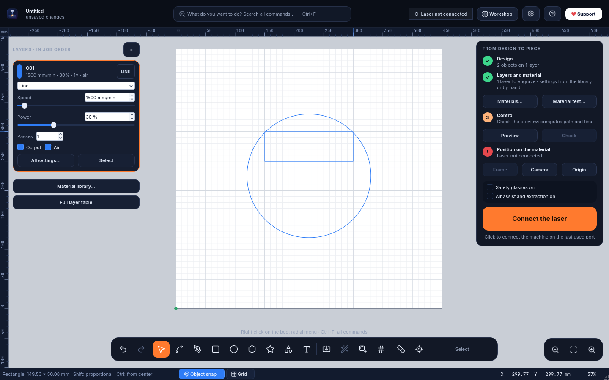
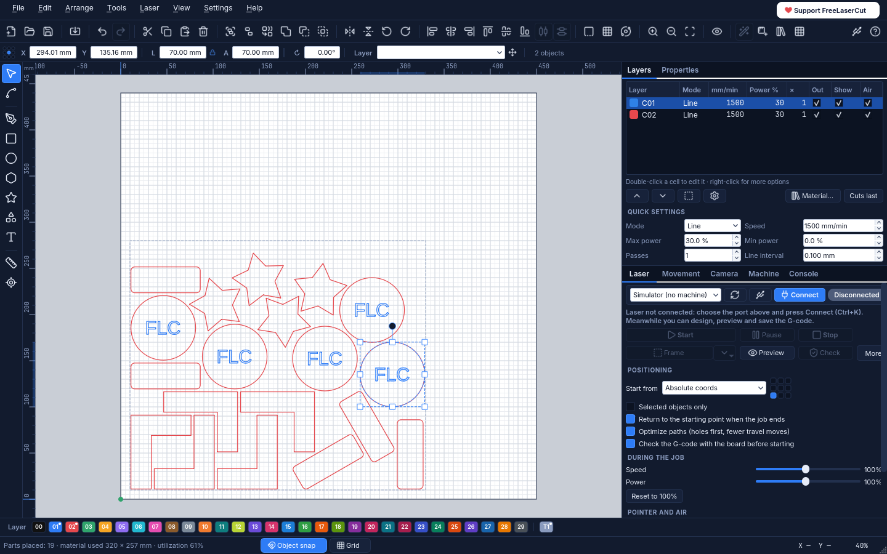

<p align="center"></p>

# FreeLaserCut (FLC)

> - **Interface languages:** English · Italiano · Español · Français · Português — *Settings → Language*.
> - **Video tutorials:** [YouTube · Free Laser Cut](https://www.youtube.com/@FreeLaserCut)
> - **Website:** https://fringuello79.github.io/FreeLaserCut/ · **Nesting** (Arrange → Optimize space, Alt+N) · ready-made profiles for Longer, Ortur, xTool, Atomstack, Sculpfun, Creality Falcon, Two Trees, Comgrow and any GRBL laser.
> - **Two interfaces:** *Workbench* (full-screen bed, command search, radial menu, second-monitor aware) or *Classic* — *Settings → Interface*.
> - Free (GPL-3.0) laser engraving and cutting software for GRBL machines, native profile for the Longer B1 40W.
> - **New in 0.22.0: the FreeLaserCut Gallery** — share your jobs and download other people's straight from the program (*File → Share to the Gallery…*), no account needed.
> - Windows installer, **Linux AppImage** and **macOS .dmg (preview, Apple Silicon and Intel)** in **Releases**. The macOS version is new and not yet tested with a real laser: testers welcome. The Linux version is the same program with the same automated tests, but real-machine testing on Linux is done by the people who install it: please report problems with *Help → Send a report to support*. Documentation below is in Italian.

Software **libero** di incisione e taglio laser per macchine GRBL, con profilo nativo per il **Longer B1 40W**.
Di **fringuello79**, con i co-sviluppatori **Evoluzione2** e **Stefano Modena** · licenza **GNU GPL 3.0 o successiva** (vedi `LICENSE`).
Video tutorial sul canale YouTube **[Free Laser Cut](https://www.youtube.com/@FreeLaserCut)** (anche dal programma: *Aiuto → Video tutorial su YouTube*).

**Versione 0.22.3** — dalla 0.22 la **Galleria FreeLaserCut**: condividi i tuoi lavori e scarica quelli degli altri direttamente dal programma (*File → Condividi nella Galleria…* e *File → Galleria FreeLaserCut…*), con anteprima, materiale e parametri, stelle e «L'ho fatto anch'io», senza account. In più «Adatta gli incastri allo spessore» (fessure, fori, tacche e linguette insieme, per un materiale di spessore diverso), la configurazione guidata che prova l'aria (M8 o M7) e, sul Mac, il minimo vero: macOS 14.4. La 0.22.2 corregge gli scatti nelle foto con molto bianco e il Contorno che spostava il lavoro con la partenza dalla testa, parte in Classica se il Banco non riesce ad aprirsi, rende più veloce «Adatta gli incastri», legge i colori numerati e dei layer dei DXF e riconosce gli SVG di Illustrator a 72 dpi. La 0.22.3 mostra e incide bene i PNG con lo sfondo trasparente (la parte trasparente non si incide mai) e aggiunge, fra le funzioni in prova, «Studia la macchina» per chi ha una K40 o un laser con scheda Ruida. Dalla 0.21.2: la Lucciola dalla tastiera (Alt+Maiusc+L), la velocità costante a laser spento, il joystick fisico (in prova), VEVOR A7 e Sculpfun iCube Ultra Dual nel catalogo.

Tutte le novità, versione per versione, sono in [`CHANGELOG.md`](CHANGELOG.md).

> Dalla 0.5.1 il programma si chiama FreeLaserCut (prima *Freeburn*). I progetti `.fbrn` si aprono ancora; i nuovi si salvano come `.flcut`.

## Installazione (Windows)

Scarica **`FreeLaserCut-<versione>-Setup.exe`** dalla pagina **Releases** di questo repository e aprilo.
Tutto il necessario è incluso: non serve installare Python e non servono permessi da amministratore.
L'installatore non è firmato digitalmente: Windows può mostrare *"PC protetto da Windows"* → **Ulteriori informazioni → Esegui comunque**.
Per verificare il file scaricato confrontalo con `SHA256SUMS.txt` della stessa release (in PowerShell: `Get-FileHash .\FreeLaserCut-<versione>-Setup.exe`).

**Aggiornare:** dalla 0.10.4 basta *Aiuto → Cerca aggiornamenti…*: FreeLaserCut scarica la nuova versione da questa pagina Releases, ne controlla l'impronta SHA-256, si chiude, si aggiorna e si riapre da solo. Al primo avvio chiede se può controllare da solo una volta al giorno (non invia dati, solo una richiesta a GitHub). In alternativa si installa la nuova versione sopra la vecchia: progetti, profili e materiali restano. La versione del Microsoft Store si aggiorna dallo Store.

## Installazione (Linux)

Scarica **`FreeLaserCut-<versione>-x86_64.AppImage`** dalla stessa pagina **Releases** (o dal sito), rendilo eseguibile e aprilo:

```bash
chmod +x FreeLaserCut-*-x86_64.AppImage
./FreeLaserCut-*-x86_64.AppImage
```

(dal file manager: tasto destro → *Proprietà* → *Permessi* → *Consenti l'esecuzione come programma*, poi doppio clic).
È un solo file con dentro tutto, come l'installatore per Windows: non serve installare niente e non servono permessi da amministratore. Al primo avvio FreeLaserCut propone di aggiungersi al **menu delle applicazioni** e di aprire i progetti `.flcut` con il doppio clic (anche più tardi, da *Aiuto*). Serve un PC a 64 bit (x86_64) con una distribuzione del 2022 o più recente: Ubuntu 22.04, Debian 12, Fedora 35, Linux Mint 21, openSUSE Tumbleweed, Arch e successive (le librerie di Qt 6 chiedono glibc 2.34 o più recente).

- **Porta USB del laser.** I driver dei chip USB (CH340, CP210x, FTDI) sono già nel sistema e la porta compare come `/dev/ttyUSB0` o `/dev/ttyACM0`. Per aprirla il tuo utente deve essere nel gruppo `dialout` (`uucp` su Arch): `sudo usermod -aG dialout $USER`, poi esci dalla sessione e rientra. *Laser → Riconosci la macchina → Permesso della porta USB…* lo spiega e copia il comando. Il collegamento in **Wi-Fi** non ha bisogno di permessi.
- **Aggiornare:** *Aiuto → Cerca aggiornamenti…*, come su Windows: FreeLaserCut scarica la nuova AppImage, ne controlla l'impronta SHA-256, la mette al posto di quella vecchia (stesso file, stessa cartella) e si riapre.
- **Se non parte:** su qualche sistema manca FUSE; allora `./FreeLaserCut-*-x86_64.AppImage --appimage-extract-and-run`. Con `--self-test` FreeLaserCut fa una prova di avvio senza toccare le tue impostazioni e stampa le informazioni tecniche da allegare a una segnalazione.
- **Claude:** l'app Claude per desktop non c'è ufficialmente per Linux; il collegamento funziona con **Claude Code** (*Aiuto → Collega a Claude* mostra la riga da usare).

### Chi collauda la versione per Linux

La versione per Linux viene costruita dallo stesso codice di quella per Windows, esce insieme a lei con lo stesso numero di versione e passa le stesse prove automatiche, più una prova di avvio su Ubuntu e su altre distribuzioni (Debian, Fedora, Arch) fatta dai server di GitHub. **Lo sviluppo e le prove con il laser e la camera veri però si fanno su Windows**: su Linux non si possono ripetere a ogni versione, perché distribuzioni, desktop e configurazioni sono troppi. Per questo **il collaudo su Linux lo fa chi installa il programma, sul proprio computer**.

Se qualcosa non va (porta USB, camera, finestre, lavoro sulla macchina, aggiornamento…), segnalalo da **Aiuto → Invia un rapporto all'assistenza**: il rapporto contiene già la distribuzione, il desktop (X11 o Wayland), lo stato delle porte USB e le altre informazioni tecniche, e parte solo con il tuo consenso. Basta raccontare cosa è successo. Ogni rapporto serve a correggere il problema per tutti nelle versioni successive, che escono sempre insieme per Windows e Linux.

## Installazione (macOS, anteprima)

Dalla 0.20.7 nella pagina **Releases** ci sono due file: **`FreeLaserCut-<versione>-macOS-arm64.dmg`** per i Mac con Apple Silicon (M1, M2, M3, M4…) e **`FreeLaserCut-<versione>-macOS-x86_64.dmg`** per i Mac Intel (menu Apple → *Informazioni su questo Mac*: «Chip Apple M…» o «Processore … Intel»). Serve macOS 14.4 (Sonoma) o più recente: le librerie grafiche di questa versione non partono sui sistemi più vecchi.

Apri il .dmg e trascina **FreeLaserCut** in **Applicazioni**. Il programma non è firmato da Apple: al primo avvio macOS lo blocca; vai in *Impostazioni di Sistema → Privacy e sicurezza* e premi **Apri comunque** (lo spiega anche il LEGGIMI nel .dmg).

- **Porta USB del laser:** compare come `/dev/cu.usbserial…` o `/dev/cu.usbmodem…`.
- **Camera:** la prima volta macOS chiede il permesso; se l'hai negato si riattiva da *Impostazioni di Sistema → Privacy e sicurezza → Fotocamera*.
- **Wi-Fi:** funziona con i laser già nella rete di casa; il primo passaggio senza cavo (il PC che si collega da solo alla rete del laser) sul Mac non c'è ancora.
- **Aggiornare:** a mano, con il .dmg nuovo (*Aiuto → Cerca aggiornamenti…* dice quando c'è).
- **Chi la collauda:** è la prima versione per Mac. Passa le stesse prove automatiche, anche sui Mac di GitHub, ma **nessuno l'ha ancora usata con un laser vero**: se hai un Mac e un laser, provala e manda un rapporto da *Aiuto → Invia un rapporto all'assistenza*.

## Lingua

Al primo avvio FreeLaserCut usa la lingua di Windows se è tra inglese, italiano, spagnolo, francese e portoghese, altrimenti l'inglese. Si cambia da **Impostazioni → Lingua / Language** (anche Visualizza → Lingua nella Classica): la nuova lingua vale dal riavvio, che il programma propone subito. I testi sono in `freelasercut/locale/<lingua>.json` (chiave = testo italiano nel codice): correzioni e nuove lingue sono benvenute. La guida "?" dei comandi per ora è solo in italiano.

## Avvio dal codice sorgente (Windows)

Doppio clic su **`run_freelasercut.bat`** (oppure sul collegamento **FreeLaserCut** del Desktop).
La prima volta, e dopo ogni aggiornamento, installa da solo le librerie nuove: ci vuole qualche minuto.

> Chiudi gli altri programmi per il laser prima di connetterti: la porta USB la può usare un solo programma alla volta.

## Le due interfacce

Al primo avvio FreeLaserCut chiede quale usare; si cambia quando vuoi da **Impostazioni → Interfaccia** (vale dal riavvio, che il programma propone). I comandi sono gli stessi: cambia solo la disposizione.

### Banco (predefinita)

<p align="center"></p>

Progettata partendo dagli studi sull'usabilità delle interfacce: bersagli grandi e vicini a dove si lavora (legge di Fitts), poche scelte per volta (Hick-Hyman), comandi che compaiono quando servono (*progressive disclosure*), menu radiali (Callahan, Kurtenbach e Buxton) e uso del secondo monitor come spazio di lavoro (Czerwinski e altri).

| Zona | Cosa c'è |
| --- | --- |
| Barra in alto | Progetto, **ricerca comandi** (Ctrl+F / F3), stato della macchina (clic = connetti), **Officina**, **⚙ Impostazioni**, guida "?", **Sostieni** |
| Sinistra | **Strati** nell'ordine di lavoro: clic su una scheda per velocità, potenza, passate, modalità, aria, incisione. « riduce gli strati a una colonna di colori |
| Destra | **Dal disegno al pezzo**: i quattro passi con il loro stato, materiali, test, anteprima, verifica, contorno, camera, origine, conferme di sicurezza e avvio (tieni premuto). Con una selezione, sopra compaiono le **Proprietà** |
| Vicino alla selezione | **Barra contestuale**: X/Y/larghezza/altezza/rotazione, livello, allinea, combina, serie, altro |
| In basso | **Isola degli strumenti** (annulla/ripeti, disegno, importa, vettorizza, misure esatte, testo variabile, misura, posiziona laser) e zoom |
| Tasto destro sul piano | **Menu radiale** con 8 comandi sulla forma sotto il cursore (o sul piano vuoto) |
| Durante l'incisione | **Cabina**: tempo rimanente, ora di fine, velocità e potenza ±10%, aria, **Pausa** e **Stop** grandi |
| Officina (Ctrl+Shift+W) | Laser, Movimento, Camera, Macchina, Console, tabella completa dei livelli. **Con due monitor va da sola sul secondo** (Impostazioni → Officina sul secondo monitor) |

### Classica

<p align="center"></p>

| Zona | Cosa c'è |
| --- | --- |
| Barra in alto | File, modifica, booleane, rifletti/ruota, allinea/distribuisci, offset, serie, zoom, anteprima · porta USB e **Connetti** |
| Barra numerica | X / Y / Larghezza / Altezza in **mm** e Rotazione, con **ancoraggio a 9 punti** e lucchetto delle proporzioni. A destra: **livello della selezione** e **centra sul piano**. I campi accettano calcoli e unità: `120/3`, `2in`, `5cm`, `+10`, `*2` |
| Strumenti (sinistra) | Selezione V · Nodi N · Linee e curve L · Mano libera H · Rettangolo R · Ellisse E · Poligono P · Stella S · Testo T · Misura M · Posiziona laser Q |
| Tavolozza (in basso) | 30 livelli colore + **T1** (livello strumenti, mai inciso): clic = assegna il colore alla selezione |
| Pannelli (destra) | **Livelli**, **Proprietà** · **Laser**, **Movimento**, **Camera**, **Macchina**, **Console**. Si spostano, si staccano e si richiudono (menu Visualizza → Pannelli) |

Premi **F1** per l'elenco completo delle scorciatoie (valgono in entrambe le interfacce).

## Ottimizza lo spazio (nesting)

**Disponi → Ottimizza lo spazio** (Alt+N; nel Banco anche dalla barra contestuale e dal menu radiale) sistema i pezzi sul materiale sprecandone il meno possibile.

- Usa la **sagoma vera** di ogni pezzo: un cerchio può entrare nell'angolo di una L, una forma irregolare accanto a un'altra.
- **Pezzi**: la selezione oppure, se non selezioni niente, tutte le forme. Le forme bloccate e quelle non selezionate restano ferme e vengono evitate. Le forme una dentro l'altra (un'incisione nel suo contorno di taglio) si spostano insieme anche senza raggrupparle; le copie sovrapposte invece vengono distribuite.
- **Materiale**: il piano intero, un rettangolo su misura oppure un contorno disegnato sul **livello T1**, anche un avanzo irregolare. Selezionalo insieme ai pezzi.
- **Distanza tra i pezzi** (almeno lo spessore del taglio), **margine dal bordo**, **rotazioni** (nessuna, 180°, 90°, 45°, 15°: con le venature del legno o le foto conviene nessuna o 180°), **precisione** normale o alta.
- Il risultato indica quanti pezzi sono stati sistemati, il materiale usato e la resa in %. I pezzi che non entrano restano dove erano e vengono selezionati. **Ctrl+Z** annulla tutto in un colpo.
- **Più pannelli**: se i pezzi non entrano, continuano su altri pannelli uguali affiancati a destra, ognuno col suo contorno e il suo numero sul livello T1. Si incide un pannello alla volta, selezionandolo e usando "Solo gli oggetti selezionati".
- **Linee di taglio comuni**: i pezzi vengono accostati e i lati in comune si tagliano una volta sola, con meno tempo e meno bruciature. Lo stesso fa *Disponi → Unisci le linee di taglio comuni* su qualsiasi selezione, per esempio una serie a griglia con distanza 0. Funziona sui lati dritti; il kerf non si applica ai lati condivisi.

## Codici QR e a barre

*Strumenti → Codice QR o a barre…* (Ctrl+Alt+Q).

- **Tipi**: QR, Code 128, EAN-13, EAN-8, UPC-A, Code 39. Il codice diventa una forma vettoriale con i moduli uniti, da incidere in **riempimento**: FreeLaserCut lo mette da solo su un livello in riempimento.
- **Opzioni**: larghezza, altezza delle barre, zona di rispetto, correzione d'errore del QR (L, M, Q, H) e numero leggibile sotto le barre.
- **In negativo**: si incide il fondo e restano chiari i moduli. Serve per anodizzato, ardesia e vernici scure, dove il laser schiarisce.
- **Serie**: nel contenuto puoi usare `{n}` (numero progressivo, `{n:4}` = 0001), `{data}`, `{anno}` e le colonne del CSV di *Testo variabile*. Con una serie a griglia ogni copia ha il suo codice.
- Il codice resta modificabile: pannello Proprietà oppure di nuovo Ctrl+Alt+Q con il codice selezionato. Prova sempre la lettura col telefono prima di incidere una serie.

## Testo su tracciato

*Strumenti → Testo su tracciato…* (Ctrl+Alt+T): seleziona un testo e una linea (o una forma) e il testo ne segue la curva.

- Si regolano la posizione sulla curva, l'allineamento, la distanza dalla curva e il verso.
- Testo, carattere e dimensione restano modificabili come in un testo normale.
- La curva resta dov'è: spostala sul livello T1 se non va incisa.

## Rotativo

*Laser → Rotativo…* serve per bicchieri, borracce, bottiglie e cilindri, con un accessorio a **rulli** o a **mandrino** collegato al posto del motore dell'asse Y.

- Indica quanti mm di asse Y fanno un giro (trovali con il pulsante **Prova: un giro**), il diametro del rullo (rulli) o dell'oggetto (mandrino).
- Disegna come su un foglio. FreeLaserCut scala l'asse Y e corregge la velocità, così quella sulla superficie resta quella scelta; anche il contorno segue il rotativo.
- Usa *Partenza → posizione attuale della testa* e metti a fuoco sul punto più alto dell'oggetto.
- Quando il rotativo è attivo, nella barra di stato compare **⟳ Rotativo attivo**: ricordati di spegnerlo quando torni al piano.

## Macchine supportate

FreeLaserCut lavora con qualsiasi laser a diodo con firmware **GRBL 1.1**, **grblHAL**, **Grbl_ESP32** o **FluidNC**, collegato via **USB** oppure via **Wi-Fi**. Il Wi-Fi funziona con le schede che accettano il G-code dalla rete, come FluidNC, grblHAL, ESP3D o l'AlgoLaser Delta.

- **Modelli pronti:** 72 profili, da scegliere al primo avvio o da *Laser → Riconosci la macchina*, anche senza la macchina collegata. Ci sono i modelli più diffusi di Longer, Ortur, xTool, Atomstack, Sculpfun, Creality, Two Trees, AlgoLaser, Genmitsu/SainSmart, Comgrow, Acmer, Mecpow, Carverall e VEVOR, più "Altro laser GRBL". Per i modelli aggiunti nella 0.12.0 i valori di targa vengono dalle pagine ufficiali dei produttori, indicate nel codice.
- **Lettura dalla scheda:** collegando la macchina, area di lavoro, scala di potenza, velocità e buffer si rileggono dalla scheda (`$$`, `$I`). Il produttore viene riconosciuto dal firmware, il modello dall'area di lavoro.
- **Wi-Fi:** con il pulsante Wi-Fi accanto alla porta scrivi l'indirizzo della scheda, per esempio `192.168.1.50`, porta 23. *Prova il collegamento* controlla che risponda e l'indirizzo resta nell'elenco delle porte.
- **Copie delle impostazioni della scheda** (*Laser → Copie delle impostazioni della scheda…*):
  - FreeLaserCut salva da solo tutti i parametri `$$` quando si collega, se sono cambiati, e prima di modificarne uno;
  - da lì si confronta una copia con la scheda e si ripristinano solo i valori diversi.
- La **libreria materiali** contiene i valori del Longer B1 40W. Con un altro laser parti dal **Test materiale** (Laser → Test materiale) e salva i tuoi valori nella libreria.

## Progetti di altri programmi (`.lbrn2`, `.lbrn`)

**File → Apri** apre anche i progetti in formato `.lbrn2` (e i vecchi `.lbrn`). Vengono importati forme, gruppi, posizioni e livelli, con le loro impostazioni:

- modalità, velocità (convertita da mm/s a mm/min), potenza massima e minima, passate;
- uscita sì/no, interlinea, tratteggio incrociato, priorità;
- la numerazione del testo variabile.

Salvandolo diventa un progetto FreeLaserCut (`.flcut`). Con **Importa** (o trascinandolo sulla tela) le forme di un progetto `.lbrn2` si aggiungono a quello aperto.

## Disegno e modifica

- **Forme:** rettangolo (anche con raggio sugli angoli), ellisse/cerchio, poligono, stella, linee e curve di Bézier. Clic semplice = forma da 20 mm; Maiusc = proporzionale; Ctrl = dal centro.
- **Galleria forme (F):** 22 forme parametriche, tutte modificabili anche dopo averle disegnate (tipo e parametro):
  - frecce semplici e doppie, cuore, croce, fulmine;
  - ingranaggio, spirale, fumetto, goccia, luna, nuvola;
  - scudo, targa, medaglia con anello, etichetta con foro;
  - anello, cornice, settore, arco, triangolo, rombo, trapezio.
- **Forma con misure esatte (Ctrl+Alt+N):** scegli tipo, larghezza, altezza e centro.
- **Testo:** tutti i font di Windows più 15 **font a linea singola** (incisione veloce in una passata). L'altezza è quella reale delle maiuscole. Grassetto, corsivo, maiuscolo, allineamento, spaziatura lettere e righe, lettere saldate.
- **Nodi:** doppio clic su una forma. Trascina nodi e maniglie, trascina un segmento dritto per curvarlo, doppio clic per aggiungere un nodo. Tasti: D elimina, C angolo, S morbido, B spezza, L raddrizza, M punto medio. Rettangoli e testi diventano tracciati da soli alla prima modifica, e anche questo si annulla. Con dei nodi scelti, *Allinea* e *Distribuisci* lavorano sui nodi.
- **Mano libera (H):** premi e trascina; al rilascio il tratto diventa un tracciato levigato. Finisci sul punto di partenza per chiuderlo.
- **Trasforma:** maniglie di scala (gli angoli mantengono le proporzioni, Maiusc le sblocca) e di rotazione (Maiusc = 15°). Frecce = 1 mm (Maiusc 10, Ctrl 0,1).
- **Selezione:** da sinistra a destra prende ciò che è dentro, da destra a sinistra anche ciò che tocca. Maiusc aggiunge, Ctrl alterna.
- **Aggancio:** a nodi, centri, angoli e punti medi delle altre forme, con indicatore; a richiesta anche alla griglia. Pulsanti in basso a destra (F9 oggetti, Maiusc+F9 griglia); Alt lo sospende mentre trascini.
- **Operazioni:** raggruppa/separa, salda, unione/differenza/intersezione/esclusione, scomponi, chiudi tracciati, unisci estremi, inverti direzione, offset (dentro/fuori/entrambi, angoli vivi/tondi/smussati), elimina duplicati, converti in tracciato, **semplifica tracciati** (meno nodi entro una tolleranza in mm), blocca.
- **Disponi:** allinea (7 modi), distribuisci (spazi o centri), stessa larghezza/altezza, sposta sul piano (9 punti), porta la testa sulla selezione, serie a griglia, serie circolare, copia lungo un tracciato.
- **File:** progetti `.flcut`, importazione SVG / DXF / PNG / JPG / BMP (anche trascinando i file sulla tela), esportazione SVG, salvataggio automatico con recupero dopo una chiusura imprevista.
- **Annulla/ripeti illimitato**, con il nome dell'azione nel menu.

## Livelli e impostazioni di taglio

Nel pannello **Livelli** ogni cella si modifica direttamente: **doppio clic** su nome, modalità, velocità (mm/min), potenza (%) o passate. Le spunte **Inc.** (incidi), **Vis.** (visibile) e **Aria** si cambiano con un clic. Il **tasto destro** su un livello apre il menu: tutte le impostazioni, rinomina, modalità, *incidi solo questo livello*, seleziona le forme, applica un materiale. Ogni modifica si annulla con Ctrl+Z.

Modalità **Linea**, **Riempimento**, **Riempimento offset**, **Immagine**. Per ogni livello: velocità (con l'equivalente in mm/s), potenza massima e minima, passate, aria, potenza costante M3 o dinamica M4.

- **Linea:** kerf (i pezzi escono a misura, i fori si compensano da soli), ponticelli.
- **Riempimento:** interlinea (con righe/pollice), angolo, tratteggio incrociato, bidirezionale, overscan, raggruppamento *Automatico*, **velocità costante anche a laser spento** (vuoti e cambi di riga alla velocità del livello: meno vibrazioni).
- **Immagine:** risoluzione, scala di grigi, soglia, Floyd–Steinberg, Jarvis, Stucki, Atkinson, Bayer, retino a punti (cella e angolo). Partenza a scelta: dall'alto o dal basso con righe orizzontali, da sinistra o da destra con righe verticali. Più negativo, correzione del punto, luminosità, contrasto e gamma per ogni immagine.

**Tagli per ultimi** riordina i livelli: prima le incisioni, alla fine le linee di taglio.

Nella scheda **Laser**, **Spostamenti a vuoto più lenti** porta tutti gli spostamenti a laser spento del lavoro e del Contorno alla velocità che scegli, invece che alla massima della macchina.

## Materiali

**Ctrl+M** (o il pulsante **Materiale…** nel pannello Livelli) apre la libreria: tutta la tabella ufficiale Longer per il B1 40W, 21 incisioni e 30 tagli con spessori, passate e sfocatura consigliata. Cerca ("tiglio 3", "acrilico"), scegli e **Applica al livello**. Le voci che salvi tu (★) hanno la precedenza su quelle Longer.

**Laser → Test materiale** incide una griglia potenza × velocità con le etichette, dal quadrato più leggero al più pesante (se qualcosa non va lo vedi sui primi). Dalla libreria puoi creare un test *intorno ai valori* di un materiale. Dopo il test scegli il quadrato venuto meglio e lo salvi in libreria con un clic. Anteprima, contorno, verifica e avvio funzionano come per un lavoro normale.

**Taratura da foto:** con *Riferimenti per leggere la foto* spuntato, agli angoli del test si incidono quattro quadratini a scacchiera. Fotografa il test dall'alto e premi *Leggi la foto del test…*: la foto può arrivare da un file, dalla camera o dal telefono. FreeLaserCut raddrizza la foto, misura quanto è scuro ogni quadrato e propone i valori per l'incisione scura, quella leggera e le foto. Il pulsante *Come si fa?* apre la mini guida.

**Materiali imparati:** nel risultato della foto premi *Impara questo materiale…*: FreeLaserCut si ricorda come risponde quel materiale (quanto scurisce con ogni energia e con che colore) e ogni nuova foto dello stesso materiale lo affina. In *Laser → Materiali imparati…* scegli un tono e ottieni la potenza a quella velocità, applicabile a un livello; con un livello Immagine in scala di grigi i grigi della foto diventano toni equidistanti sul legno vero. L'anteprima realistica e *Prepara foto* mostrano il risultato previsto su quel materiale. I materiali imparati si esportano e importano in un file `.json`.

## Vettorizzazione

Seleziona un'immagine → **Alt+T** (o **Vettorizza…** nelle Proprietà). Due modi:

- **contorno**: i bordi delle zone scure diventano tracciati chiusi, da riempire o tagliare;
- **linea centrale**: scritte a mano, firme e disegni a tratto diventano una linea sola, incisa in una passata.

Soglia automatica o manuale, dettaglio, morbidezza, spigoli vivi, filtro delle macchie, anteprima dal vivo sopra la foto.

## Testo variabile e testo curvo

Nel testo usa `{N}` (numero di serie), `{N:3}` (001), `{DATA}`, `{ANNO}`, `{ORA}` o il nome di una colonna di un CSV tra graffe, per esempio `{Nome}`. Dal pulsante **Inserisci variabile** o da **Strumenti → Testo variabile…** imposti numero, incremento, cifre e carichi il CSV.

- Le copie di una **serie a griglia o circolare** si numerano da sole: 20 portachiavi numerati in un lavoro.
- A fine lavoro il numero (e la riga del CSV) **avanza da solo**, così il lavoro dopo continua.

**Curvatura** (Proprietà del testo): ampiezza dell'arco in gradi. Positivo = a ponte, negativo = a sorriso, ±360° = testo tutto intorno (targhe, medaglie, trofei). Accanto vedi il diametro del cerchio.

## Riconoscere la macchina

**Laser → Riconosci la macchina…** (o l'icona USB in alto a destra e nella barra di connessione):

- elenca le porte USB con il **chip** (CH340, CP210x, FTDI, ESP32) e il **driver** che usa;
- **Installa driver dal PC…** installa un driver che hai già scaricato (.exe, .msi o .inf); **Scarica il driver** apre la pagina ufficiale del chip; c'è anche il collegamento a Gestione dispositivi;
- **Riconosci** interroga la scheda (prova da sola le velocità di comunicazione), legge firmware, area di lavoro, scala di potenza e buffer e propone nome e profilo;
- **Usa il profilo e connetti** salva il profilo, lo rende attivo e si collega. I profili salvati si scelgono dal menu in alto.

Se colleghi una macchina diversa da quella del profilo attivo, FreeLaserCut se ne accorge dopo la connessione e propone il riconoscimento.

**Velocità della porta seriale:** di partenza 115200 baud, quella standard di GRBL, e *Riconosci* trova da solo quella giusta. Se sai che la tua scheda ne usa un'altra: *Laser → Velocità della porta seriale…* (o tasto destro su **Connetti**), scegli o scrivi il valore, **Prova questa velocità** (non muove niente e non cambia il profilo) e poi **Salva nel profilo**. Se dopo la connessione la scheda non risponde, FreeLaserCut lo dice e propone queste due strade.

## Galleria FreeLaserCut

I lavori fatti con FreeLaserCut si condividono e si scaricano dal programma, senza account.

- **Condividere:** *File → Condividi nella Galleria…* con il progetto aperto. Compili titolo, categoria, materiale e spessore, lavorazione, due righe di descrizione e licenza (CC BY 4.0, CC BY-NC 4.0 o CC0), e se vuoi un nome pubblico e fino a 3 foto del pezzo finito. Anteprima, misure e tempo li aggiunge il programma. Spunti le due caselle («è opera mia…» e «accetto le regole») e premi **Condividi**.
- **Sfogliare:** *File → Galleria FreeLaserCut…*. Cerchi per parola, categoria e lavorazione; ordini per voto, per «fatto da» o per data. **Apri come progetto nuovo** porta il lavoro sul piano con i livelli dell'autore: potenza e velocità sono quelle del suo laser, controllale sul tuo prima di incidere.
- **Votare e segnalare:** da 1 a 5 stelle, **L'ho fatto anch'io**, **Segnala…** (non funziona, copiato, pubblicità, non adatto).
- **I miei lavori:** i lavori condivisi da questo computer, con lo stato e **Togli dalla Galleria**.

Parte solo quello che vedi nella finestra: il progetto ripulito, l'anteprima, le foto (senza i dati EXIF) e i dati del modulo; mai percorsi, nomi dei file, nome del computer o della porta. Un numero a caso, salvato sul tuo computer, distingue l'installazione per voti e limiti. I controlli sono automatici (testi, file, doppioni e un modello di intelligenza artificiale sulle immagini); i lavori segnalati da più persone si nascondono da soli. Il servizio è nel repository [`FreeLaserCut-galleria`](https://github.com/fringuello79/FreeLaserCut-galleria). Dettagli nell'[informativa sulla privacy](https://fringuello79.github.io/FreeLaserCut/privacy.html).

## Guida "?"

Il pulsante **?** in alto a destra (o **Maiusc+F1**) attiva la guida: passa il mouse su un comando, un campo, una colonna o una voce di menu e compare la descrizione, con la scorciatoia, le opzioni (per menu e tendine) e il valore attuale. In questa modalità i clic non eseguono nulla. **Esc** per uscire.

## Lavorare con la macchina

1. **Connetti**, poi **Homing**: FreeLaserCut impara da solo come la scheda conta le coordinate.
2. Scegli la **partenza**: coordinate assolute, posizione attuale della testa o origine utente, più il punto di ancoraggio.
3. **Contorno**: la testa percorre il perimetro a laser spento. Ci sono anche il contorno stretto e il contorno con un filo di laser.
4. **Avvia**: controlli preliminari, riepilogo, poi la **verifica del G-code dentro la scheda** (modalità di controllo, nessun movimento) e solo dopo la partenza.

Durante il lavoro:

- **override di velocità e potenza** dal vivo (10–200%);
- pausa/riprendi e stop sicuro;
- avanzamento e tempo restante.

**Joystick fisico (in prova).** Nella scheda **Movimento**, sotto «Togli origine», scegli il controller (Logitech G13 in modalità joystick, pad Xbox o PlayStation, joystick USB) e spunta **Attivo**: va riacceso a ogni avvio, sulle macchine con l'homing solo dopo l'homing. La testa va al massimo alla «Velocità jog» (mai oltre 6000 mm/min) e la levetta è ignorata se FreeLaserCut non è in primo piano, durante un lavoro o in allarme. Dal pulsante **…** regoli la zona morta e il verso e assegni i pulsanti a Stop, Homing, Vai a X0 Y0, passo, «piano», Z e Contorno a laser spento: nessuno accende il laser.

Se la scheda rifiuta una riga, il lavoro va **subito in pausa** e FreeLaserCut ti dice quale riga e perché.

Se si stacca il cavo o manca la corrente, al riavvio FreeLaserCut propone di **riprendere il lavoro da dove si era fermato**, dopo l'homing.

**Il puntino.** Il B1 non ha un puntatore rosso: il puntino è il laser blu a potenza minima (massimo 5%). La stessa potenza serve al pulsante **Puntino** (acceso finché lo tieni premuto, si spegne da solo dopo 20 secondi) e al **contorno con il puntino**: la testa percorre il rettangolo del lavoro e vedi sul materiale dove passerà il laser. È il comportamento predefinito del pulsante **Contorno**. Dal menu accanto puoi scegliere il contorno stretto, il giro ripetuto 3 volte o il contorno a laser spento. **Contorno → Regola il puntino…** ti guida a trovare la potenza giusta: abbastanza per vederlo, troppo poca per segnare.

## Anteprima

Simulazione con cursore temporale e riproduzione (da 1× a 500×), percorsi colorati per potenza e trasferimenti tratteggiati. La finestra si apre grande quanto lo schermo con il lavoro adattato; **rotella** = zoom verso il cursore, trascina = sposta, **doppio clic** o tasto **0** = adatta di nuovo.

La **resa realistica** mostra come verrà la bruciatura su betulla, pioppo, noce, cartone, pelle, ardesia o anodizzato. Le zone troppo cotte o troppo chiare si vedono prima di sprecare materiale.

## Camera (AutoCam)

Scheda **Camera** → **Calibra automaticamente**. FreeLaserCut calibra con il puntino del laser all'1–3%, oppure, se non si vede, incidendo un bersaglio su un cartone. Poi la foto del piano compare raddrizzata e in scala 1:1 sotto il disegno.

## Guardia fiamme

**Laser → Guardia fiamme…** È spenta di partenza. Se la attivi, durante il lavoro FreeLaserCut guarda la camera del pannello Camera: se vede una fiamma per circa un secondo, ferma il lavoro, spegne il laser, suona e salva una foto nella diagnostica. Ignora il puntino del laser, la brace normale, le scintille isolate e le luci sempre presenti nell'inquadratura. La sensibilità si sceglie e si prova dal vivo. È un aiuto in più: non sostituisce la sorveglianza.

## Controllo dal telefono

**Laser → Controllo dal telefono…** È spento di partenza. Spunta la casella e inquadra il codice QR con il telefono, che deve essere sullo stesso Wi-Fi del PC. La pagina mostra l'avanzamento e la camera, ha i pulsanti Pausa e Stop e permette di inviare la foto del test materiale.

- Avviare o riprendere un lavoro si fa solo dal PC.
- La pagina risponde solo alla rete di casa e l'indirizzo ha un codice casuale, che si può cambiare.
- La prima volta Windows può chiedere il permesso di rete: scegli **Reti private**.

## Comandi da Claude (MCP)

**Aiuto → Collega a Claude…** → **Configura Claude per desktop**, poi chiudi e riapri l'app Claude. Da quel momento puoi chiedere in chat, per esempio: «crea una medaglia da 60 mm con il testo SRM 2026 curvo in alto, taglio in tiglio 3 mm» oppure «apri il logo SRM e dimmi quanto ci mette».

Claude può:

- creare forme, testi e tracciati;
- spostare, allineare, combinare e moltiplicare in serie;
- impostare livelli e materiali;
- importare, aprire e salvare file;
- vettorizzare immagini;
- guardare il disegno e stimare il lavoro;
- muovere la testa e fare il contorno.

**Il laser non lo avvia mai da solo:** compare la solita conferma sullo schermo e sei tu a premere Avvia. FreeLaserCut accetta comandi solo da questo PC (127.0.0.1, con una chiave). Se FreeLaserCut è chiuso, Claude lo apre.

## Sicurezza

Laser di classe 4, 450 nm. Indossa occhiali protettivi adatti, non lasciare mai la macchina incustodita mentre lavora e tieni attivi aria e aspirazione.

## Ringraziamenti

FreeLaserCut migliora perché qualcuno lo prova, lo racconta e ci dice che cosa non va. Grazie a: Stefano Modena, MakerHub, leone2805, Evoluzione2, rinosp, Brenda-IT, giorgiobattisti56-wq, giuseppegrassano77-coder, OrsoLaser, Roberto C., SpikeTheDragon40k, Deborah, Paolo1968, DolomiticHunter, Mauro C., Gianni, marcello, Sengir, Daniel Z., solboricua, universalecinema-boop, Paul H.

Gli stessi nomi compaiono sulla schermata di avvio e in *Aiuto → Ringraziamenti*. Fino alla versione 0.20.6 l'elenco ringrazia anche chi ci ha lasciato il proprio nome in un rapporto all'assistenza. Da qui in poi raccoglie chi aiuta FreeLaserCut in modo attivo e con regolarità (prove ripetute, idee, codice, traduzioni) o con una donazione. Se è il tuo caso, scrivi il tuo nome nel campo «Nome per i ringraziamenti» quando mandi un rapporto da *Aiuto → Invia un rapporto all'assistenza*.

## Licenza, garanzia, sostegno

FreeLaserCut è software libero: puoi usarlo, studiarlo, modificarlo e ridistribuirlo alle condizioni della GNU GPL 3.0 o successiva. È fornito **così com'è, senza alcuna garanzia**: chi usa la macchina ne resta responsabile.

Caratteri Inter e JetBrains Mono (SIL OFL), icone Lucide (ISC), font a linea singola Hershey: licenze in `freelasercut/assets/licenses`. L'installatore include Python, Qt/PySide6 e altre librerie con le loro licenze: elenco e testi in `LICENZE-TERZE-PARTI.md` e nella cartella `licenze-terze-parti/`.

**Nome e logo.** Il nome *FreeLaserCut* e il logo restano di fringuello79 e non sono concessi con la GPL: chi distribuisce una versione modificata deve darle un altro nome e un altro logo.

**Sostieni il progetto.** FreeLaserCut è gratuito e completo, e lo resterà. Se ti è utile puoi contribuire allo sviluppo con una donazione volontaria tramite [GitHub Sponsors](https://github.com/sponsors/fringuello79) (pulsante **Sponsor** in alto in questa pagina) o [PayPal](https://paypal.me/alessandrofelli), oppure da **Aiuto → Sostieni FreeLaserCut** nel programma. Anche una ⭐ aiuta. Grazie!

## Costruire l'installatore

```bash
python build/prepara_installer.py
makensis -DVER=<versione> build/installer.nsi
```

Serve Python 3.10 o più recente con internet (lo script scarica Python per Windows e le librerie ufficiali) e [NSIS 3](https://nsis.sourceforge.io). Il risultato è `build/FreeLaserCut-<versione>-Setup.exe`.

**Versione per Linux** (su un Linux x86_64): `python build/prepara_appimage.py` → `build/FreeLaserCut-<versione>-x86_64.AppImage`, con lo stesso Python e le stesse librerie dell'installatore per Windows.

**Versione per macOS** (su un Mac, Apple Silicon o Intel): `python build/prepara_mac.py --arch arm64` (o `x86_64`) → `build/FreeLaserCut-<versione>-macOS-<arch>.dmg`, con lo stesso Python e le stesse librerie, firma ad hoc.

Lo stesso lo fa GitHub da solo con il workflow **Installatori Windows, Linux e Mac** (`.github/workflows/installatore.yml`): Actions → Run workflow, oppure pubblicando un tag `vX.Y.Z`. Con il tag costruisce e prova tutte le versioni e crea una sola Release con l'installatore, l'AppImage, i due .dmg e `SHA256SUMS.txt`; se la parte Linux o quella Mac non passa la prova, la Release esce senza (Windows è la versione principale).

**Firma e Microsoft Store**: le strade per togliere l'avviso di SmartScreen sono spiegate in [`build/FIRMA-E-STORE.md`](build/FIRMA-E-STORE.md):

- il Microsoft Store, gratuito: lo Store firma il pacchetto MSIX preparato da `build/prepara_msix.py`;
- SignPath Foundation, gratuito per l'open source;
- un certificato personale Certum.

L'installatore si firma con `makensis "-DSIGN=signtool sign …"`.

## Test

`tests\esegui_test.bat` (doppio clic, risultato in `tests\ultimo_test.log`) oppure `python tests/run_tests.py` (circa 4 minuti) · `python tests/run_tests.py --camera` (circa 8 minuti).
I test usano un simulatore che si comporta come il B1 vero: stessi parametri, stesso firmware, stesso formato di stato.
